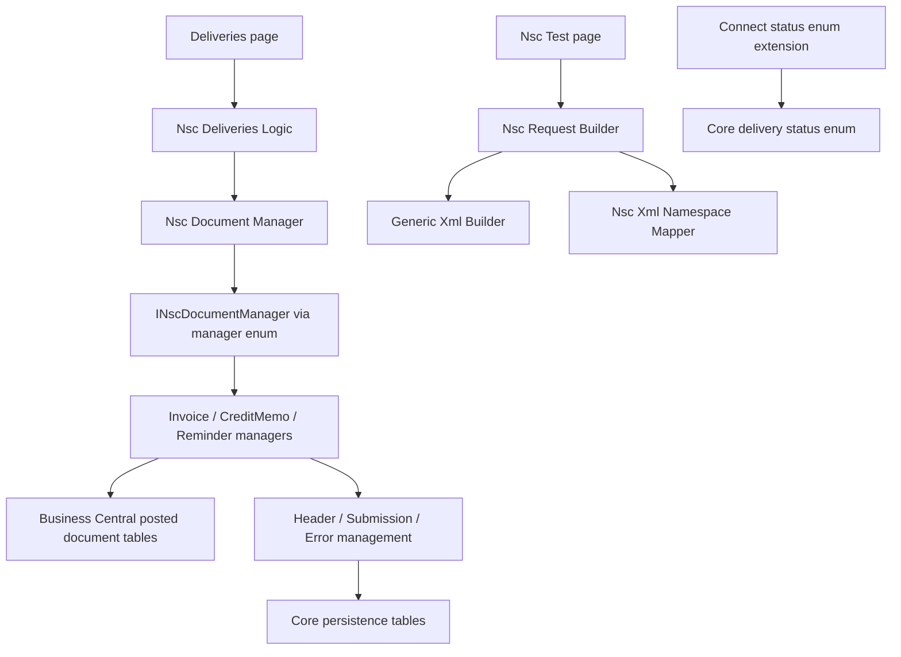
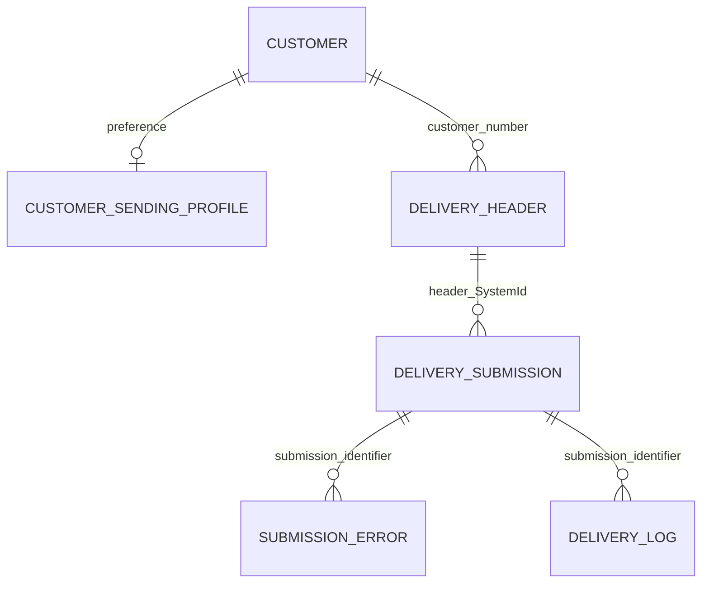

# Nem Strålfors Connect architecture

## Reading this document

This is a source-based description of the working tree inspected on 2026-11-15, including its uncommitted restructuring. It describes current implementation, not a target design or a guarantee of working end-to-end delivery. Source links are relative to this directory. Exact AL object and procedure names are included for AI-assisted navigation.

**Current state:** a Microsoft Dynamics 365 Business Central AL extension containing document collection, delivery/submission records, and a separate Strålfors XML builder. The intended product sends posted sales documents through PostNord Strålfors Connect. There is no implemented transport connecting these two flows. Several persistence inconsistencies also prevent the collection flow from functioning as its structure suggests; see [Current limitations](#current-limitations).

## Runtime and project boundaries

| Property | Current value |
| --- | --- |
| Production manifest | [app.json](app.json) |
| App / publisher / version | NemStrålforsConnect / Aurora Software / 1.0.0.0 |
| App ID | `ebf97941-460f-4fd3-a028-3e2b89725b6d` |
| Business Central application / platform | `27.5.46862.47835` / `27.0.46760.0` |
| AL runtime | `16.1` |
| Object ID range | `1000000`–`1001999` |
| Explicit extension dependencies | None; code uses Microsoft application and System objects |
| Features | `NoImplicitWith`, `TranslationFile` |
| Source namespace | `Nsc.<folder-structure>` |
| Test extension | [NemStraalforsConnect.Tests](../NemStraalforsConnect.Tests/app.json), dependent on this app at `1.0.0.0`; IDs `1002000`–`1003999`, runtime `16.0`, application `27.0.0.0` |

This is one deployable production extension, not separate Core and Connect services. Its tables persist within Business Central; no external database or application server is implemented here. No table sets `DataPerCompany = false`, so the custom tables use the normal company-specific storage model.

[AGENTS.md](AGENTS.md) specifies the `Nsc` namespace pattern. The [editor settings](.vscode/settings.json) still propose `AS.Nsc.$(parentFolder)` for generated namespaces; current source uses `Nsc`. Preserve exact existing names when navigating. In particular, `Persistance` is the actual folder and namespace spelling.

## Components and dependencies

| Area | Responsibility and entry points |
| --- | --- |
| [Core/UI](source/Core/UI) | Setup, account profile, delivery list/card, submission list part, customer sending preference, and XML demonstration page. `Nsc Deliveries` exposes **Fetch new documents**. |
| [Core/RoleCenters](source/Core/RoleCenters) | `Nsc Profile` role profile selects `Nsc Role Center`, whose controls provide a delivery-list shortcut. The cue is a constant, not a calculated delivery count. |
| [Core/Extensions](source/Core/Extensions) | Extends Customer/Card with exclusion and sending-profile configuration. Posted sales invoice extensions currently contain commented-out functionality. |
| [Core/Logic](source/Core/Logic) | Collection orchestration; document-specific adapters; header, submission, error, and sending-profile management. |
| [Core/Abstractions](source/Core/Abstractions/INscDocumentManager.interface.al) | `INscDocumentManager`, the common document-access and collection contract. |
| [Core/Enums](source/Core/Enums) | Document type and implementation dispatch, sending preference, delivery channel/status, and account type. |
| [Core/Persistance](source/Core/Persistance) | Seven custom tables for configuration, delivery state, and supporting records. |
| [Core/DataExchangeFormats/Xml](source/Core/DataExchangeFormats/Xml) | Generic XML creation and parsing helpers. |
| [Connect/Logic](source/Connect/Logic) | `Nsc Request Builder` composes Strålfors-specific XML; `Nsc Xml Namespace Mapper` resolves namespace URIs. |
| [Connect/Enums](source/Connect/Enums) | XML namespace keys and provider-specific additions to the core delivery-status enum. |
| [Core/PermissionSets](source/Core/PermissionSets) | Base, User, and Admin permission sets; currently only partial coverage. |

The two execution branches are separate: no submission-to-request-builder call or outbound network call exists. Core logic does not depend on Connect, but the demonstration page inside `Core/UI` does. Thus the folder split is not a strictly enforced dependency boundary.

## Persistent data model

Every table also has Business Central system fields, including `SystemId`. A custom GUID primary key and `SystemId` are distinct identifiers and must not be treated as interchangeable.

| Table | Declared primary key | Purpose and references |
| --- | --- | --- |
| `Nsc Setup` | `SetupId` (auto-increment integer) | Document inclusion/display flags, sender system ID, delivery type ID, and certificate/private-key BLOBs. Setup page creates a record when none exists; consumers use `FindFirst`, rather than an enforced singleton key. |
| `Nsc Profile` | `ProfileId` (integer) | Trial/Standard account type; company name and company ID are FlowFields. Separate from the AL role profile also named `Nsc Profile`. No account-verification service is implemented. |
| `Nsc Customer Sending Profile` | `Customer No.` | One sending preference per customer; currently only Email is declared. The customer-card part inserts a missing row when opened with a customer filter. |
| `Nsc Delivery Header` | `Document Type`, `Document No.` | One header per source document/type, plus customer number. Submission references use the header's `SystemId`. |
| `Nsc Delivery Submission` | `Sending Id` (GUID) | Header reference, status, channel, and recipient snapshot: name, address, postal code, country code, and email. No PDF/payload field or recipient city field exists. |
| `Nsc Delivery Submission Error` | `Error No.` (integer) | Error message and submission GUID; has a secondary index on `Delivery Submission Id`. |
| `Nsc Delivery Log` | `Entry No.` (GUID) | Submission GUID, message, and status at change. `AddLog` assigns a GUID to its primary key; its two-argument overload finds the submission by `SystemId`. |

The intended logical relationships are:

These are application-level references, not declared `TableRelation` constraints. The delivery card explicitly filters its submission part by header `SystemId`. The schema can represent multiple submissions per header, but collection currently attempts only one and no resend workflow exists. Submission identifiers are used inconsistently in the implementation, as detailed below.

## Document collection flow

Entry point: [Nsc Deliveries](source/Core/UI/NscDeliveries.Page.al), action `FetchNewDocuments`, calling `Nsc Deliveries Logic.CreateNewDeliveriesAndSubmissions()`.

1. Require a setup record and inspect `IncludeInvoices`, `IncludeCreditMemos`, and `IncludeReminders`.
2. For each enabled type, call `Nsc Document Manager.FetchDocuments(DocumentType)`. Its explicit case statement selects a value of `Nsc Document Managers`, whose `Implementation` property supplies an `INscDocumentManager` implementation.
3. The concrete manager scans its posted document table using `FindSet`. There are no date or customer-exclusion filters. Invoice and credit memo customer lookup uses `Sell-to Customer No.`; reminders use `Customer No.`.
4. `Nsc Delivery Header Mgt.ShouldCreateDelivery` skips an existing `(Document Type, Document No.)` and publishes `OnBeforeCreateDeliveryHeader` to allow a subscriber to veto new creation.
5. `CreateDelivery` inserts the header, resolves the customer through the dispatcher, displays the new `SystemId` with `Message`, and returns that ID.
6. `Nsc Delivery Submission Mgt.CreateDocumentAsSubmission` finds that header by `SystemId`, requires a customer sending-profile record, maps its preference to a delivery type, assigns `NoStatus`, inserts a submission, and returns its `SystemId`. Only Email-to-Email mapping is implemented. The `DocumentNo` parameter is unused; the header supplies the document reference.
7. The manager checks required address fields, records individual errors, and invokes its validation integration event. Invoice/credit memo checks use bill-to name/address/city/postal code/country; reminder checks use the reminder's corresponding fields.
8. Based on validation, the manager requests `ReadyForSending` or `FailedValidation`, then requests recipient population from the current Customer record.

Steps above describe the call sequence, not a successful execution guarantee. In particular, identifier defects can prevent status and recipient updates. Also, validating a posted document's bill-to address is different from populating the recipient from the current sell-to customer.

Collection runs synchronously from the UI. There is no job queue, per-document error isolation, or explicit `Commit` in this path. Missing setup/customer preferences or record lookup errors abort execution through AL errors. Some submission operations instead silently return when their record lookup fails. Existing headers are skipped on subsequent collection, so this is not a revalidation or retry mechanism.

### Status semantics

| Status | Current implementation |
| --- | --- |
| `NoStatus` | Explicitly assigned while creating a submission. |
| `ReadyForSending`, `FailedValidation` | Requested after validation; the primary-key lookup defect can make the updates no-ops. |
| `MarkedForSending`, `Sent` | Declared only; no send transition is implemented. |
| `ValidationFailedByPostnord`, `AcceptedByPostnord`, `ReceivedByEnduser`, `FetchingStatus` | Added by `Nsc Connect Delivery Status`; no provider-response/status processing is implemented. |

`ReadyForSending` has enum value zero; `NoStatus` is value four. Do not infer the initial status from the enum's default value. The status setter accepts an enum value without enforcing a transition graph or writing a log.

## Strålfors XML construction

[Nsc Request Builder](source/Connect/Logic/NscRequestBuilder.Codeunit.al) provides individual methods that mutate a supplied `XmlElement`. It does not read delivery records, serialize a complete submission automatically, or send a request.

- `PrepareDocumentAndReturnRoot()` creates `ForsendelseI` in `urn:oio:fjernprint:3.0.0` and declares the `dkal` namespace (`urn:oio:dkal:1.0.0`). It returns the root element, not the `XmlDocument`.
- Helper methods add dispatch/type identifiers, a CPR recipient group, PDF format name, caller-supplied base64 content, document parameters, and username/channel parameters.
- The CPR element uses `urn:oio:adir:dagpenge:2009.07.01`. `Nsc Xml Namespace Mapper` only maps the `dkal` enum value; unknown values raise an error.
- `Xml Builder` handles element creation, text, attributes, groups, and namespace declarations. Overloads without an explicit element namespace inherit the parent's namespace URI.
- `Xml Parser` wraps XML parsing and child XPath selection. It does not implement a Strålfors response parser or supply a namespace manager for prefixed XPath queries.

[Nsc Test](source/Core/UI/NscTest.Page.al) manually invokes the builder with demonstration values and displays the XML in a message. This demonstrates construction only; PDF generation, base64 encoding, schema validation, authentication, HTTP transport, response correlation, and status polling are absent. XML samples in [sample-data](sample-data) are reference assets, not an executable integration specification.

## Extensibility and operational configuration

`INscDocumentManager` exposes `GetDocument(DocumentNo): RecordRef`, `GetCustomerNo(DocumentNo): Code[20]`, and `FetchDocuments()`. Implementations adapt `Sales Invoice Header`, `Sales Cr.Memo Header`, and `Issued Reminder Header`. `GetDocument` is available as an abstraction, but the current collection path does not use it to render documents.

Adding a document type requires coordinating the document-type enum, manager implementation/enum mapping, and the dispatcher's explicit case statement. Collection selection is also explicitly coded from setup flags. Extensible enums alone do not make discovery automatic. The same limitation applies to new sending preferences/channels and XML namespaces: their mapping code must recognize new values.

Published integration events are `OnBeforeCreateDeliveryHeader` and `OnAfterValidateInvoiceAsSubmission`, `OnAfterValidateCreditmemoAsSubmission`, and `OnAfterValidateReminderAsSubmission`. Validation events expose the document and validity flag by reference, but not the submission ID. No subscribers are present in this project.

The setup page uploads `.cer` and `.pfx` streams into table BLOBs. The table's `ReplaceCertificate` and `ReplaceCertificateKey` procedures are TODO stubs; the page implements uploads directly. No certificate authentication or key-password handling is wired into a transport. Sample certificate assets exist under `sample-data`; their contents and password are deliberately not reproduced here.

`Nsc Base Usage` grants execution of `Xml Parser` only. `Nsc User` includes that base set; `Nsc Admin` additionally grants setup table/data/page access. These sets do not cover the complete delivery workflow. The manifest exposes debugging/source downloads and has an empty Application Insights connection string. Log-table methods exist but are not invoked by the collection/status workflow.

## Current limitations

These observations are based on static source inspection, not runtime reproduction. They are part of the current implementation and should not be mistaken for architectural requirements.

| Observation | Architectural consequence / source |
| --- | --- |
| Credit memo and reminder managers pass `Document Type::Invoice` to duplicate checking and header creation. | Dispatch may resolve an invoice with the same number, fail when none exists, or skip a different document. See [CreditMemo manager](source/Core/Logic/NscCreditMemoManager.codeunit.al) and [Reminder manager](source/Core/Logic/NscReminderManager.codeunit.al). |
| Submission insertion leaves `Sending Id` unassigned but returns `SystemId`; status/recipient methods call `Submission.Get` with that returned ID. | `Get` targets the custom primary key, so those updates ordinarily return without finding the row. Repeated insertion also risks duplicate empty-GUID keys. See [submission management](source/Core/Logic/NscDeliverySubmissionMgt.Codeunit.al) and [submission table](source/Core/Persistance/NscDeliverySubmission.Table.al). |
| Error insertion does not assign `Error No.`, and the field is not auto-incrementing. | Multiple errors can collide on the default primary key. See [error management](source/Core/Logic/NscDeliveryErrorMgt.Codeunit.al) and [error table](source/Core/Persistance/NscDeliverySubmissionError.Table.al). |
| `ClearErrors` calls `SetRange("Delivery Submission Id")` without a value, then `DeleteAll`. | The supplied submission ID is not applied as a filter; the operation can delete all error records in the current company. |
| `ExcludeFromReceiving` is exposed on the customer but never consulted by collection. | Its UI description does not reflect enforced selection behavior. |
| Setup display flags are not consumed by the deliveries page. | Configuration currently does not change that list's displayed fields. |
| The delivery list has no `CardPageId` or explicit action opening the delivery card. | The card/submission part exists, but ordinary list-to-card navigation is not wired there. |
| Logging, provider statuses, certificate storage, and account fields are present without their full workflows. | Their presence does not establish audit coverage, delivery, authentication, or account verification. |
| Test coverage is scaffolding. | No evidence currently establishes correct persistence or end-to-end behavior. |

## Tests and developer navigation

The sibling test app contains an empty [XmlBuilder Tests](../NemStraalforsConnect.Tests/Tests/Core/DataExchangeFormats/Xml/XmlBuilder.Codeunit.Tests.al) codeunit and [NscConnectRequestBuilder Tests](../NemStraalforsConnect.Tests/Tests/Source/Connect/NscConnectRequestBuilder.Codeunit.Tests.al), whose single test constructs a root but contains no assertion. The latter still imports `Nsc.Connect`, while the builder now resides in `Nsc.Connect.Logic`; compilation should be verified after the namespace restructuring. No build or tests were run for this documentation change.

The editor enables CodeCop and UICop with a [local ruleset](.vscode/Nsc-rules.ruleset.json). The test manifest also targets older application/runtime versions than the production manifest. Use compatible Business Central symbols and an AL test environment when validating code changes; this repository snapshot does not establish a passing build or a complete automated test runner.

| Change or investigation | Start here |
| --- | --- |
| Which documents get collected? | `Nsc Deliveries Logic`, concrete document managers, and `Nsc Delivery Header Mgt.ShouldCreateDelivery`. |
| Add or inspect document adapters | `INscDocumentManager`, `Nsc Document Managers`, and `Nsc Document Manager.MapDocumentTypeToManagerType`. |
| Diagnose IDs, status, recipients, or duplicates | Persistence keys plus `Nsc Delivery Submission Mgt` and `Nsc Delivery Header Mgt`; distinguish custom keys from `SystemId`. |
| Change customer delivery preferences | Customer card extension, `Nsc Sending Profile Part`, customer preference table, and `Nsc Sending Profile Mgt`. |
| Adjust validation/errors | Concrete managers and `Nsc Delivery Error Mgt`; validation and recipient population use different data sources. |
| Change provider XML | `Nsc Request Builder`, namespace mapper/enum, `Xml Builder`, and sample XML. |
| Investigate sending or retries | No implementation exists yet; do not infer one from enum values or sample assets. |
| Change setup, access, or navigation | Setup table/page, permission sets, role center, and delivery pages. |

For future updates to this document, follow executable calls and actual table keys rather than captions or commented code. Keep implemented behavior, observed defects, and intended capabilities explicitly separate. Do not restore deleted pre-restructuring paths or infer an active delivery-provider interface from Git history.
